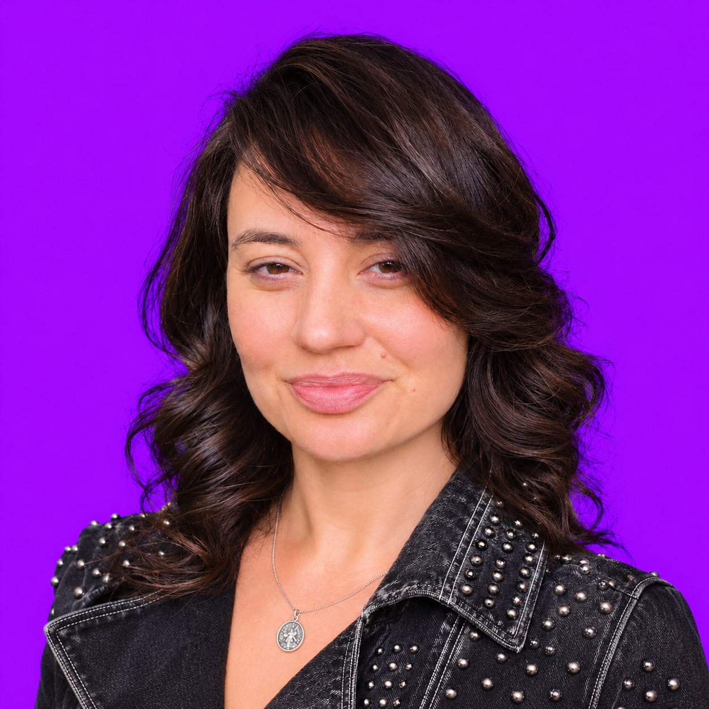

# Chloe Starr brand kit

Version 1.0.0. Verified against the live website November 7, 2026.

## Source of truth

Use [chloestarr.me](https://chloestarr.me/) and this kit together. The live homepage CSS is assets/brand/homepage.css. Its Chloe font alias resolves to DM Sans, not a separate proprietary font. Earlier Bodoni/gold/teal local studies are historical drafts and must not override this current identity.

## Identity

chloe starr. One orange period. Filmmaker. Writer. AI builder. Content Is Liquid.

Chloe is the sole founder of ompom.ai. Preserve her founder, writer, poet and filmmaker identity. For commercial roles lead with commercial evidence; for community roles lead with organizer-network construction; for creative roles show actual work and credits. Do not invent metrics or convert pre-AI experience into AI experience.

## Canonical headshot

When Chloe says "my headshot", use assets/brand/approved-headshot.png. Exact Git blob: 363df83ea2bff25df055d1fa45ce335e0a42406f. Live URL: https://chloestarr.me/assets/brand/approved-headshot.png

Preserve the real face, hair, expression, black studded jacket, silver pendant and electric-purple background. Crop to fit while preserving face and pendant. Do not regenerate, retouch identity, recolor, make monochrome or replace with older photographs unless Chloe specifically requests it. The gold architectural temple is a separate artwork, never a substitute portrait.

## Visual system

DM Sans. Near-black #090b12, off-white #f5f5f2, orange #ff713d, muted #b8c4cf, divider #273340. Strong typography, generous space and clear hierarchy. Purple belongs to the unchanged portrait; gold belongs to the temple artwork. No cream/brown canvas or generic purple gradients.

For CVs use a white print surface with near-black text, the same sans-serif character and restrained orange punctuation. DM Sans regular with Arial Bold as an explicit print fallback for emphasis. Keep all content selectable, single-column and readable. No skills bars, decorative icon-only contact links or photo-dependent meaning. Put portfolio and verified socials in the contact block. Headshots remain available for bios, speaker sheets and other portrait-bearing materials.

## CV evidence and story

A clear opening connects current founder/creator work to the target contribution. Bullets explain action, context and outcome. Use strong verified examples: SyncSketch first sales hire and $600K+ revenue; Unity Skydance 125 to250 seats; Indie Hackers 7 to60+ monthly meetups through recruiting and coaching local organizers. Use role-specific evidence rather than repeating one generic biography. Preserve corrected chronology and collaborator credits. Never force an invented number into a bullet.

## Reuse and checks

Read tokens.json before creating branded material. Use the canonical portrait. Match the current role and story, verify claims, render every PDF page and inspect it, test social and portfolio links, then save the exact version sent. Supersede rejected layouts without rewriting historical submission receipts. This kit is a visual and editorial reference, not permission to publish or contact anyone.

## Research

GitHub guidance consulted: [resume-best-practices](https://github.com/StephanieKoehl/resume-best-practices), [cv-ats top third](https://github.com/filnik/cv-ats/blob/main/guides/03-the-top-third.md). Used for hierarchy, evidence-led bullets and parseable layout. These repositories are guidance, not proof of hiring outcomes at OpenAI or any employer.
